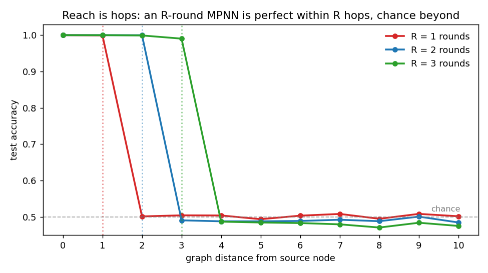
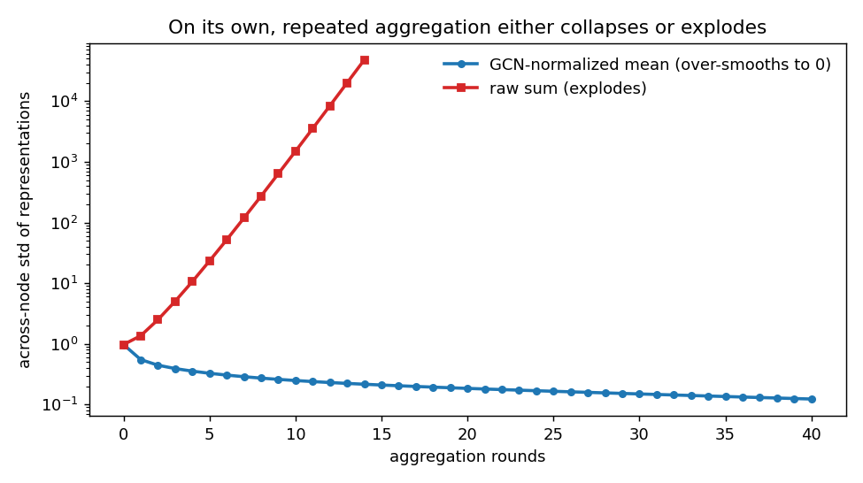
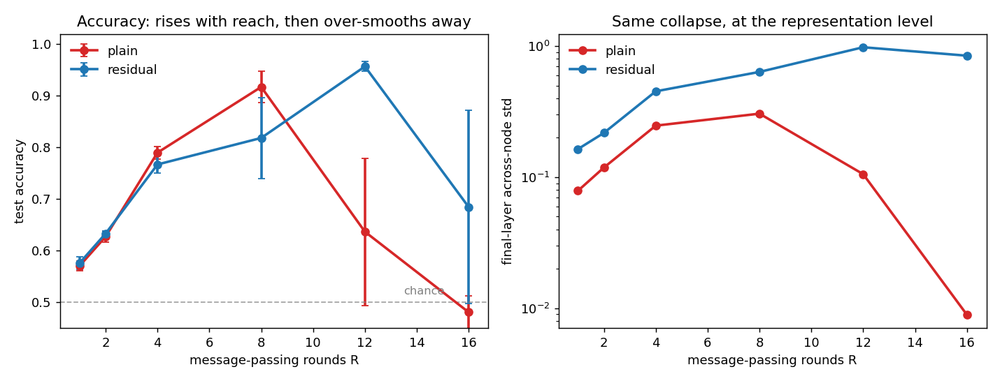

+++
date = '2026-06-17T09:00:00+08:00'
draft = false
title = 'Sutskever 30 #19：消息一跳一跳地传，传多了整张图糊成一个点'
description = '一张随机树，一个源点身上藏了一个 bit，让每个节点都把它报出来。只看自己特征的分类器在非源点上卡在 0.501，因为那一位信息只能沿着边爬过来。一轮消息传递正好走一条边，所以 R 轮的网络在 R 跳以内全对、R 跳以外抛硬币——把源点 bit 一翻，第 R+1 跳的预测精确不动。但图上加深度不是白来的：反复聚合是扩散，节点表示会被拖向同一个向量，准确率涨到一个峰再塌回 0.5，最后一层节点间的方差掉到 0.009。残差能把这堵墙往后推一截，推不掉。'
categories = ['AI', 'Sutskever 30']
tags = ['Sutskever 30', 'Graph Neural Networks', 'Message Passing', 'MPNN', 'Over-smoothing', 'GCN', 'Notebook Reading']
+++

一张随机树，二十来个节点，其中一个是源点，身上藏着一个 bit。其余节点身上也各有一个 bit，全是噪声。任务只有一句话：每个节点都要报出源点那个 bit。

我先拿一个只看自己特征的逐节点分类器跑了一遍。它在源点上 100% 正确——源点带着标记，那个 bit 本来就在它自己手里——在其余每一个节点上，0.501。非源点身上那个 bit 是我特意撒的噪声，跟答案统计独立，所以一个看不见邻居的网络在这些位置上能做的最好的事就是抛硬币。这道题被设计成必须用图：源点的值只能沿着边一格一格爬到别人那里。

于是问题变成，一轮消息传递到底能把这个 bit 带多远。

## 一轮消息传递，正好一条边

Gilmer 他们 2017 年那篇 *Neural Message Passing for Quantum Chemistry* 干的事，是把之前一堆各叫各名字的图网络（GG-NN、GCN、interaction networks……）收进同一个抽象里：每个节点先收邻居发来的 message，把它们 aggregate 成一个向量，再拿这个向量 update 自己的状态，跑几轮之后 readout 出图级或节点级的预测。我把它扒到只剩骨头，一轮长这样：

$$h_v' = \tanh\!\Big(W_s\, h_v + W_n \sum_{w \in N(v)} \hat A_{vw}\, h_w + b\Big)$$

`h_v` 是节点 `v` 的隐状态，求和跑遍它的邻居，`Â` 是归一化后的邻接矩阵（下面会细说）。关键在求和那一项：一个节点这一轮只能拿到它直接邻居的状态。所以源点的信息每过一轮只能往外渗一跳。要让距离 `d` 的节点知道源点的值，至少得跑 `d` 轮。

这跟 [#18](/posts/ai/sutskever-18-dilated-convolutions/) 是同一面墙，只是从序列搬到了图上：那边是感受野，一维卷积每层把视野撑大固定几格；这边是跳数，每轮消息传递把视野撑大一跳。把训好的网络按节点到源点的图距离分桶，逐桶看准确率：



R=1 的网络在距离 1 以内全对，距离 2 起掉到 0.5；R=2 多撑一格，距离 3 起掉下去；R=3 再多一格。三条断崖整整齐齐，各自落在自己的跳数上。桶内数字是 R=1 视野内 1.000 / 视野外 0.503，R=2 是 1.000 / 0.496，R=3 是 0.997 / 0.483。

断崖外面是真的零，不是小。我做了 [#18](/posts/ai/sutskever-18-dilated-convolutions/) 里那种翻位检查的图版本：拿一个 R=5 的网络，只把源点那个 bit 翻一下，看每个节点的预测变了多少。距离 0 到 5 的节点预测都在动（从 `2.1e-2` 一路衰到 `1.1e-3`），距离 6 的节点，`max|Δpred| = 0.000e+00`。源点的值在五轮里物理上到不了第六跳，损失函数上不存在任何让它到达的路径。

顺带留意视野内那串数字怎么一路衰下去的：源点自己 `2.1e-2`，五跳之外还在视野里但只剩 `1.1e-3`，二十倍的落差。够得着的地方，信号也已经细了——这个伏笔等下要还。

## 深度在图上不是白来的

既然远处的源点要靠多轮才够得着，那把轮数堆上去不就行了。卷积那边的确是这样，#18 里视野越大越好，dilation 只是让它更便宜。图上不行。

先看聚合这个操作自己会干什么，不训练，纯拿随机初始的节点向量反复聚合，量每一轮节点之间的标准差（节点彼此差多少）：



上面那条红线是直接求和（`Â = A`）：每轮把邻居加起来，幅度滚雪球，十轮就涨到 `1.5e3`，再训也是 NaN 伺候。所以真实的图网络都要归一化。最常见的是 GCN 那套，加自环再对称归一：

$$\hat A = \tilde D^{-1/2}\,\tilde A\,\tilde D^{-1/2}, \qquad \tilde A = A + I$$

蓝线就是它。幅度是稳住了，可方差在单调往下掉——`0.97` 起步，十轮 `0.25`，四十轮 `0.12`，奔着零去。归一化的均值聚合本质是一步扩散，反复做就是随机游走收敛到稳态，每个节点都被推向同一个向量。在稀疏的树上靠它自己塌得慢（第二大特征值离 1 很近），可一旦套进训练，这事就凶了。

把真正能训的网络按深度扫一遍，GCN 归一化聚合，普通更新对残差更新，各跑三个种子：



左图普通版那条红线先涨后塌：R=1 到 R=8 准确率从 0.57 爬到 0.917，轮数够着了越来越多的源点；过了峰再加深就开始烂，R=12 是 0.637（种子之间已经吵起来了，±0.143），R=16 直接 0.481，回到抛硬币。右图是同一件事在表示层的样子：普通版最后一层的节点间方差，R=8 还有 0.306，R=16 掉到 `0.0089`，比峰值小了三十多倍。节点表示真的糊成了一个点，readout 面对一堆几乎相同的向量，自然什么都分不出来。准确率塌下去不是没训够，是表示先死了。

这就是图网络深度的两难。远处的依赖逼你加轮数，加轮数又把节点表示往一块儿抹平。中间那个峰是这两股力气拉扯出来的甜区，跟 #18 那种「视野越大越好」的单调曲线完全两个形状。

## 残差能把墙往后推

塌成一个点这件事，听着耳熟。[#16](/posts/ai/sutskever-16-resnet/) 里普通深网随深度退化，[#17](/posts/ai/sutskever-17-identity-mappings/) 里说那条 skip 得留成干净的恒等。同一招搬过来：更新改成

$$h_v' = h_v + \tanh\!\Big(W_s\, h_v + W_n \sum_{w} \hat A_{vw}\, h_w + b\Big)$$

每个节点把自己上一轮的状态原样加回来，聚合只负责往上叠增量。图里那条蓝线就是它：峰值从普通版的 R=8 推到了 R=12，而且峰更高（0.957）；右图它的方差也一直撑在 0.6 到 1 之间，没有塌。R=12 这个位置上，普通版已经 0.637 在散架，残差版还稳稳 0.957——skip 让能用的深度多出去一大截。

墙没拆，只是挪远了。再往深到 R=16，残差版自己也开始飘，0.685 而且 ±0.188，三个种子里有的还是塌了。恒等那一路让信号留得住，可聚合每轮照样在抹平，攒够轮数它还是赢不过扩散。真要把图网络做很深，后面那一摞专门治过平滑的零件（PairNorm、DropEdge、把各层输出跳着拼起来的 JK-Net 之类）就是冲这个来的，残差只是其中最朴素的一个。

## 这套框架后来怎么走

Gilmer 那篇的贡献不在某一个具体网络，在那个 message / aggregate / update / readout 的抽象——把之前互相看不顺眼的一堆图网络写成了同一个式子的不同填法，然后在 QM9 上预测分子的量子化学性质，十三个目标里多数刷到了化学精度。之后的 GCN、GraphSAGE、GAT，区别基本都落在这四个槽里：message 怎么算，邻居怎么加权，aggregate 用 sum 还是 mean 还是 attention。这个 demo 里 sum 和 mean 的那点拉扯（一个保信号但会炸，一个稳但会糊），放大了就是这些变体之间真实的取舍。

跟系列前面对一下。[#14](/posts/ai/sutskever-14-relation-networks/) 的 Relation Networks 把所有节点两两配对，是「全连接的图」；[#05](/posts/ai/sutskever-05-transformer/) 的 self-attention 也是每个 token 对全序列算权重，等于在一张全连接图上做带 attention 权重的消息传递。GNN 这一支换了个前提：图本来就稀疏，信息只沿真实的边走，省下全连接的开销，代价就是这篇里的两面——够远要靠多跳，多跳又会过平滑。attention 那支用一跳到位的全局寻址绕开了跳数问题，但也得为每步对全序列算权重买单。两条路解的是同一个长程依赖，账算在不同地方。

## 代码

完整 notebook 在 [ZhenchongLi/sutskever-30-reading](https://github.com/ZhenchongLi/sutskever-30-reading)，在原来只有前向演示的 `12_graph_neural_networks.ipynb` 上补了手推反向和训练，文件 `12_graph_neural_networks_rerun_20260617.ipynb`。里面这些事：用 Prüfer 序列生成均匀随机树的源点广播任务；纯 NumPy 的 MPNN（message/aggregate/update/readout，手推 backward，梯度检验分线性精确版和 tanh 版）；只看自己特征的基线证明图是必需的；置换等变性检查；R=1/2/3 的逐距离准确率断崖，加翻转源点 bit 的精确零检查；聚合算子自身的过平滑/爆炸；按深度扫普通对残差，同时记准确率和最后一层节点方差两张曲线。

---

### Run Metadata

- repo: [ZhenchongLi/sutskever-30-reading](https://github.com/ZhenchongLi/sutskever-30-reading)
- notebook: `12_graph_neural_networks_rerun_20260617.ipynb`（在 `12_graph_neural_networks.ipynb` 基础上加手推反向与训练）
- 2026-06-17 执行通过（`jupyter nbconvert --to notebook --execute --ExecutePreprocessor.timeout=1800`），约 8 分钟，无报错
- 关键输出：梯度检验——线性网络中位 `5.6e-8`（最差 `5.8e-6`，有限差分截断所限）、线性+残差中位 `6.2e-9`、tanh 网络中位 `6.6e-8`；基线——只看自身特征的逐节点分类器源点 `1.000`、非源点 `0.501`；置换等变 `max|Δ| = 3.5e-18`；逐距离准确率（视野内/外）R=1 `1.000/0.503`、R=2 `1.000/0.496`、R=3 `0.997/0.483`；翻转源点 bit——距离 5 处 `mean|Δpred| 1.1e-3`、距离 6 处 `max|Δpred| = 0.000e+00`；过平滑（节点方差）均值聚合 40 轮 `0.974 → 0.123`、求和聚合 10 轮 `0.974 → 1.49e3`；深度扫描——普通版准确率 R=8 峰 `0.917`、R=16 `0.481`，最后一层方差 R=8 `0.306` → R=16 `0.0089`；残差版峰推到 R=12 `0.957`、R=16 `0.685±0.188`，方差一直 `0.6–1.0`
- Python `3.13.2` / NumPy `2.4.4` / Matplotlib `3.10.8`

### 怎么跑

```bash
cd ~/code/sutskever-30-implementations
jupyter lab 12_graph_neural_networks_rerun_20260617.ipynb
```

选 kernel `Python (sutskever-30)`。

### 备注

- Gilmer et al. 2017 *Neural Message Passing for Quantum Chemistry*（arXiv 1704.01212）原始场景是 QM9 分子性质回归，贡献是把多种图网络统一成 message/aggregate/update/readout 框架。这里的 demo 把它换成一个最小的节点级任务，为的是让「跳数」和「过平滑」两件事能量出来，不是复现分子性质
- 任务用均匀随机标号树（Prüfer 解码），距离分布够宽，断崖才看得出落在不同跳数上。源点 bit 翻转的精确零是结构性的，跟训不训练无关——R 轮的网络对第 R+1 跳的输入没有任何计算路径
- 过平滑那张结构图是聚合算子自身的行为（无训练、无权重），在稀疏树上靠它自己塌得慢；训练后的塌缩快得多（普通版 R=16 方差 `0.0089`），因为每轮的可学权重和非线性把收敛加速了。GCN 归一化里加自环很关键，树是二部图，不加自环的纯随机游走会在两类节点间来回振荡而不是收敛
- 残差「把墙往后推一截」是单数据集小模型上的观察（每点 3 个种子，R=16 处残差版方差 ±0.188，有的种子也塌了）。定性结论（skip 延后过平滑但治不好）跟 PairNorm/DropEdge/JK-Net 这些后续工作的动机一致，定量数字别往大图、深模型上外推
- sum 聚合保信号但幅度爆炸（10 轮 `1.5e3`），mean/GCN 聚合稳但会过平滑——逐距离断崖那几张图用的是 sum（视野内能干净地恢复到 1.0），深度扫描用的是 GCN 归一化（真实图网络的常态，过平滑才登场）

---

$$\text{article}^* = \underset{\theta}{\arg\min}\ \mathcal{L}_{\text{lizcc}}(\theta), \quad \theta \in \lbrace\text{Joe, Weaver, Ruyi, Thorn}\rbrace$$
